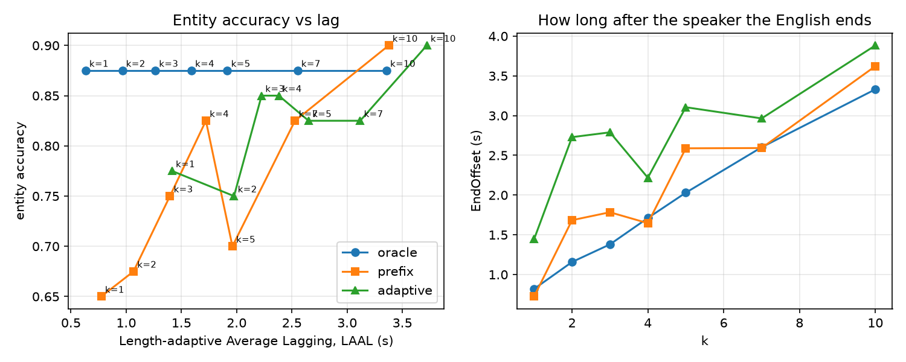

# RESULTS

Commit 8c9db26-dirty · Python 3.12.14 · torch 2.11.0+cu128 · NVIDIA GeForce RTX 5060 Ti

Every table below is regenerated by `make results`; the command under each heading reproduces it alone.

## D1 Clips

`python tools/make_results.py`

| clip | duration s | words | sentences | entities (gold) | negations | self-repairs |
|---|---|---|---|---|---|---|
| clip01 | 37.2 | 84 | 7 | 3 | 1 | 1 |
| clip02 | 33.2 | 78 | 6 | 4 | 3 | 1 |
| clip03 | 32.8 | 78 | 7 | 9 | 2 | 0 |
| clip04 | 30.5 | 76 | 6 | 4 | 2 | 0 |
| clip05 | 37.0 | 70 | 6 | 8 | 1 | 1 |
| clip06 | 29.3 | 70 | 6 | 3 | 3 | 0 |

## D3–D4 Alignment: 30 hand-marked boundaries vs MMS_FA

`python align/eval_boundaries.py`

| boundaries | n | mean abs ms | median abs ms | bias ms | ≤20 ms | ≤50 ms | ≤100 ms | >200 ms | 95% CI of mean (bootstrap) |
|---|---|---|---|---|---|---|---|---|---|
| starts | 30 | 44 | 29 | +33 | 33% | 63% | 90% | 0 | 30–58 |
| all | 30 | 44 | 29 | +33 | 33% | 63% | 90% | 0 | 30–58 |

Largest errors: clip02 'nau' +147 ms; clip02 'naain' +109 ms; clip06 'baarah' +107 ms; clip04 'iiemaaaii' +97 ms; clip02 'nau' +96 ms

## D5–D6 Checker vs human verdicts, and entity preservation per system

`python checker/eval_checker.py eval`

| entity type | n | checker accuracy | precision | recall | TP | FP | FN | TN |
|---|---|---|---|---|---|---|---|---|
| AMT | 48 | 100% | 100% | 100% | 45 | 0 | 0 | 3 |
| DATE | 4 | 100% | 100% | 100% | 4 | 0 | 0 | 0 |
| DIG | 12 | 100% | 100% | 100% | 8 | 0 | 0 | 4 |
| NAME | 44 | 100% | 100% | 100% | 44 | 0 | 0 | 0 |
| NEG | 40 | 98% | 100% | 97% | 36 | 0 | 1 | 3 |
| TIME | 16 | 88% | 93% | 93% | 13 | 1 | 1 | 1 |
| all | 164 | 98% | 99% | 99% | 150 | 1 | 2 | 11 |

| system × version | entities | preserved (checker) | preserved (human) |
|---|---|---|---|
| it2 mt | 41 | 88% | 88% |
| llm fluent | 41 | 95% | 100% |
| llm literal | 41 | 100% | 100% |
| nllb mt | 41 | 85% | 83% |

Checker disagrees with human on 3 of 164 labelled rows:

- clip02:5 llm fluent TIME "6:00" (che baje) -> checker 0, human 1: “Call any time after six in the evening, okay?”
- clip04:4 llm fluent NEG 1 (aur pliz mujhe roz roz pramoshanal esaem) -> checker 0, human 1: “And please stop sending me promotional SMS every day; it's very irritating.”
- clip05:4 nllb mt TIME "4:00" (caar baje) -> checker 1, human 0: “Site visit tomorrow at four... no, no, at four thirty.”

## E (ML track): wait-k on the clips' timeline

`python partE_ml/wait_k.py`

| regime | k | AL s | LAAL s | StartOffset s | EndOffset s | pauses >250 ms | entity acc | abandoned value spoken |
|---|---|---|---|---|---|---|---|---|
| oracle | 1 | 0.63 | 0.63 | 0.26 | 0.82 | 41 | 88% (40) | 2/3 |
| oracle | 2 | 0.97 | 0.97 | 0.64 | 1.16 | 39 | 88% (40) | 2/3 |
| oracle | 3 | 1.26 | 1.26 | 0.90 | 1.38 | 38 | 88% (40) | 2/3 |
| oracle | 4 | 1.59 | 1.59 | 1.27 | 1.71 | 37 | 88% (40) | 2/3 |
| oracle | 5 | 1.92 | 1.92 | 1.63 | 2.03 | 38 | 88% (40) | 2/3 |
| oracle | 7 | 2.55 | 2.55 | 2.25 | 2.60 | 35 | 88% (40) | 2/3 |
| oracle | 10 | 3.36 | 3.36 | 3.38 | 3.33 | 27 | 88% (40) | 2/3 |
| prefix | 1 | 0.70 | 0.77 | 0.26 | 0.72 | 52 | 65% (40) | 3/3 |
| prefix | 2 | 0.94 | 1.07 | 0.64 | 1.68 | 47 | 68% (40) | 3/3 |
| prefix | 3 | 1.30 | 1.40 | 0.90 | 1.78 | 38 | 75% (40) | 3/3 |
| prefix | 4 | 1.64 | 1.72 | 1.27 | 1.65 | 35 | 82% (40) | 3/3 |
| prefix | 5 | 1.89 | 1.96 | 1.63 | 2.59 | 36 | 70% (40) | 3/3 |
| prefix | 7 | 2.49 | 2.53 | 2.25 | 2.59 | 33 | 82% (40) | 2/3 |
| prefix | 10 | 3.37 | 3.38 | 3.38 | 3.62 | 28 | 90% (40) | 3/3 |
| adaptive | 1 | 1.36 | 1.42 | 0.26 | 1.45 | 43 | 78% (40) | 2/3 |
| adaptive | 2 | 1.91 | 1.98 | 0.64 | 2.73 | 35 | 75% (40) | 3/3 |
| adaptive | 3 | 2.15 | 2.23 | 0.90 | 2.79 | 33 | 85% (40) | 3/3 |
| adaptive | 4 | 2.33 | 2.38 | 1.27 | 2.22 | 29 | 85% (40) | 3/3 |
| adaptive | 5 | 2.60 | 2.65 | 2.08 | 3.11 | 30 | 82% (40) | 3/3 |
| adaptive | 7 | 3.10 | 3.12 | 2.60 | 2.96 | 27 | 82% (40) | 3/3 |
| adaptive | 10 | 3.71 | 3.72 | 3.47 | 3.88 | 25 | 90% (40) | 3/3 |

## Tests

`python tests/test_checker.py && python prototypes/test_hindi_number_parser.py && python partE_ml/wait_k.py --test`

OK: checker tests passed
OK: 59 phrases and 4 tests passed
OK: wait-3 AL = 2.625, and k+i indexing gives 3.6875

## Known limitations

- **n = 30 boundaries** gives a wide confidence interval; the bootstrap range above is the honest error bar. All 30 are word *starts* at hard spots (amounts, repairs, English switches), so the figure is pessimistic for ordinary words.
- **MMS_FA frames are 20 ms**, so ±10 ms is the resolution floor; human labellers disagree by roughly 16 ms on Buckeye.
- **Number parser:** dates come out as plain amounts ("pandrah August" → 15), so dates are labelled by hand in gold; "ek three BHK" is read as the digit string "13"; two falling bare numbers ("nau aath") are AMBIG; a phone number with a pause in the middle splits into two DIG groups; a lone "ek" is dropped as the article ("ek request"), which would also drop a genuine "ek".
- **Checker failure cases (from the human verdicts):** times said as phrases ("six in the evening") are not parsed; a negation carried by a verb with no cue word ("please *stop* sending") is missed; a bare hour without "o'clock" ("at four… no, four thirty") is not read as a time, so a leaked abandoned time is missed. Negation is a count of cues, not scope.
- **Self-repairs:** both open MT systems kept every abandoned value ("five lakhs. No. Five crores."); IndicTrans2 even turned "chaar baje… nahi nahi, saadhe chaar" into "4:00 p.m. or 4:30 p.m.". No read/write policy fixes this; it has to come from training targets.
- **LLM translations** were written by the same model that wrote the checker, so their 100% is checked against blind human verdicts, not the checker alone.
- **Part E** is an offline simulation on gold transcripts with an external MT model (NLLB-200). That would be a banned cascade in the real system; here it only measures where prefix translation breaks. English words last a fixed 0.35 s. 40 entities: one entity moves accuracy by 2.5 points.
- **Transcripts** were drafted with Whisper large-v3-turbo, which silently deleted self-corrections, wrote numbers as digits, merged "double chaar" into one digit and hallucinated a "kar do kar do…" loop over trailing silence; every draft was corrected by ear and checked against the audio with the aligner.
